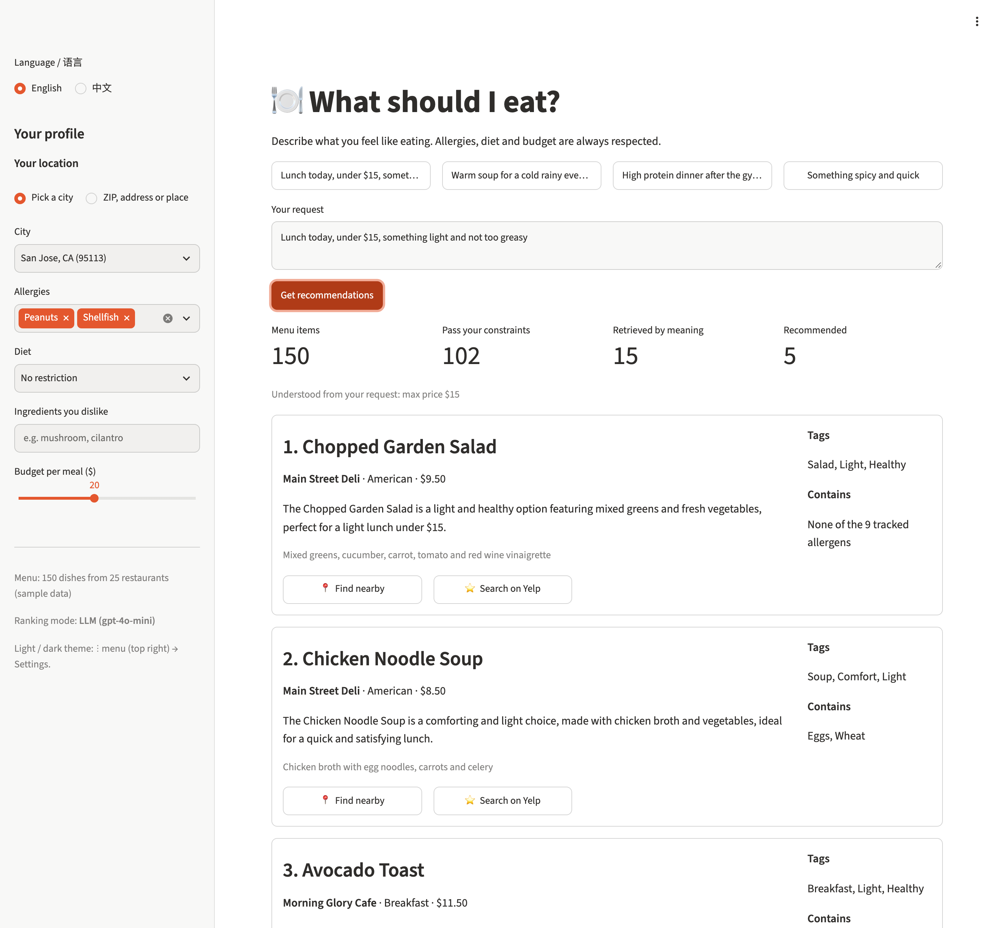
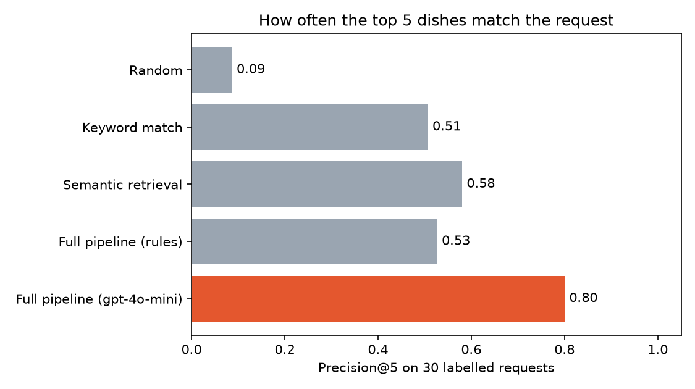
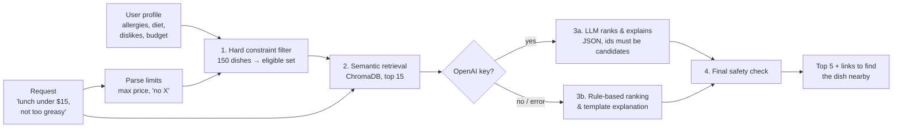
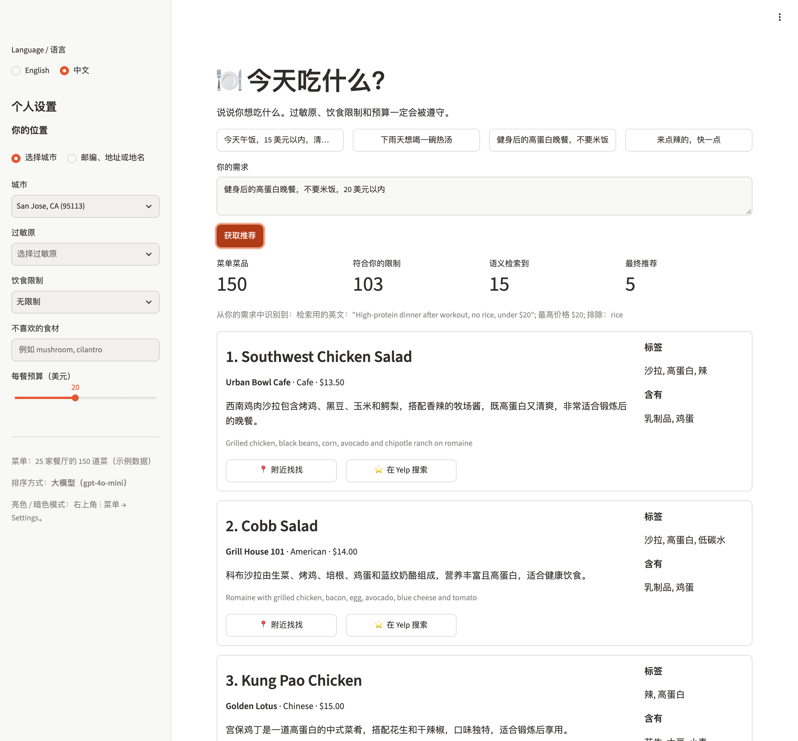
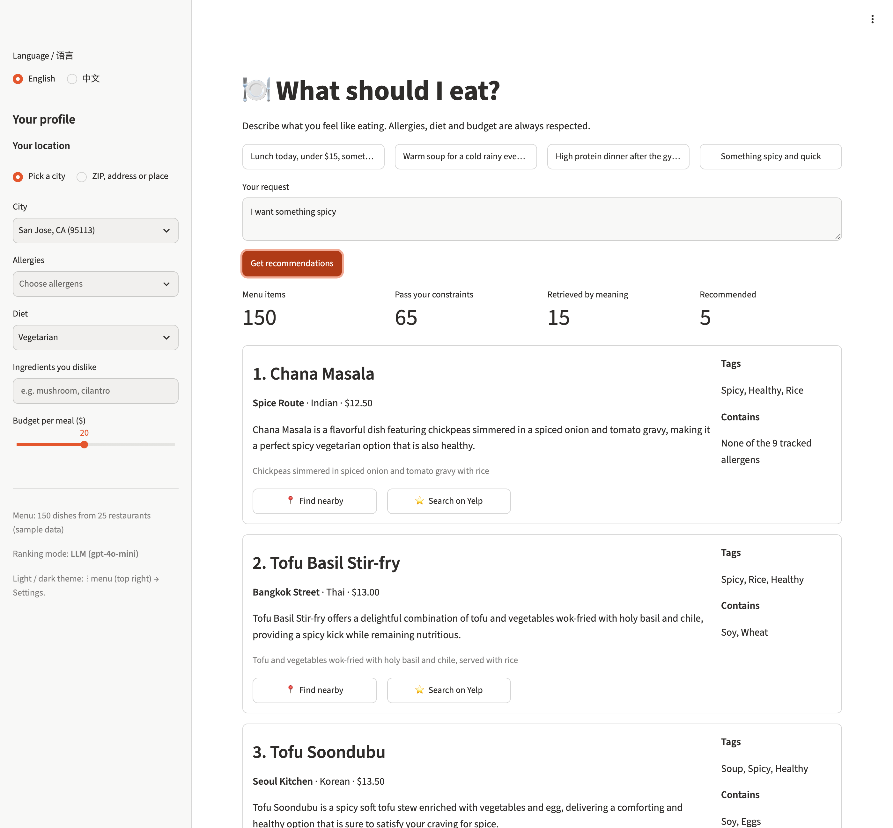

# RAG Meal Recommender

A food-ordering assistant that turns a plain-English request like *"lunch under $15, something light and not too greasy"* into five dish recommendations that always respect the user's allergies, diet and budget, each with a short explanation.

**Python · ChromaDB · sentence embeddings · OpenAI API · Streamlit · pydantic · pytest**

English and Chinese interface · light and dark theme · location by city, ZIP code, address or place name



## Contents

1. [The problem](#1-the-problem)
2. [Results](#2-results)
3. [How it works](#3-how-it-works)
4. [Design decisions](#4-design-decisions)
5. [Evaluation](#5-evaluation)
6. [Run it locally](#6-run-it-locally)
7. [Project structure](#7-project-structure)
8. [Limitations and next steps](#8-limitations-and-next-steps)

---

## 1. The problem

Deciding what to eat is a small, daily, surprisingly tiring decision. Delivery apps make it worse: they show hundreds of options and only coarse filters, and a user with a peanut allergy, a vegetarian diet and a $15 budget has to check every dish by hand.

A large language model can understand requests like "something warm for a rainy day", but on its own it is the wrong tool for the job:

- It **invents dishes** that are not on any menu.
- It **cannot guarantee safety**: a prompt saying "avoid peanuts" is a request, not a rule.
- It does not know prices or ingredients of a specific menu.

This project combines the two: **code enforces the hard rules, retrieval finds real dishes, and the LLM only ranks and explains what retrieval found** (retrieval-augmented generation, RAG).

## 2. Results

Measured on a 150-dish sample menu with `python -m evaluation.evaluate --llm`:

| | Result |
| --- | --- |
| Constraint violations in 1,500 recommendations (300 random user profiles) | **0** (vs 66.6% if retrieval runs without the constraint filter) |
| Precision@5 on 30 labelled requests, full pipeline with `gpt-4o-mini` | **0.80** |
| Precision@5, semantic retrieval alone / keyword matching / random | 0.58 / 0.51 / 0.09 |
| LLM picks that were not in the candidate list (hallucinated dishes) | **0** in 30 requests (and they would be discarded if they occurred) |
| Median response time without LLM (local embeddings) | about 40 ms |



## 3. How it works



### Step 0: Parse the request

Limits written in the request become hard constraints too. `"under $15"` caps the price (stricter than the profile budget if lower), and `"no rice"` or `"without onions"` excludes ingredients. Style phrases such as `"not too greasy"` are left to retrieval and ranking.

```python
parse_request("high protein, no rice, not too greasy, under $15")
# RequestConstraints(max_price=15.0, excluded_terms=['rice'])
```

### Step 1: Hard constraint filter (code, not prompt)

Every dish is checked against allergies, diet, budget and disliked ingredients. Diets follow explicit rules: a vegan dish is also vegetarian, a vegetarian dish is also pescatarian. Common group words are expanded, so "no cheese" also removes mozzarella and parmesan, "no pork" removes bacon and pepperoni, and "no nuts" removes every dish labelled with a nut allergen.

```python
DIET_ACCEPTS = {
    "vegan": {"vegan"},
    "vegetarian": {"vegetarian", "vegan"},
    "pescatarian": {"pescatarian", "vegetarian", "vegan"},
    "gluten_free": {"gluten_free"},
}

def violations(item, profile, request) -> list[str]:
    reasons = []
    if set(item.allergens) & set(profile.allergies):
        reasons.append("contains allergen ...")
    if profile.diet and not set(item.dietary) & DIET_ACCEPTS[profile.diet]:
        reasons.append(f"not {profile.diet}")
    ...  # budget, request max price, disliked / excluded ingredients
    return reasons
```

### Step 2: Semantic retrieval with ChromaDB

Each dish's name, cuisine and description is embedded once with `all-MiniLM-L6-v2` (Chroma's default model, run locally via ONNX, so retrieval needs no API key). The request is embedded the same way, and the search is **restricted to the ids that passed step 1**, so retrieval can only return eligible dishes.

```python
self._collection.query(
    query_texts=[query],
    n_results=min(k, len(allowed)),
    ids=allowed,               # only dishes that passed the hard constraints
)
```

This is what lets *"something warm and brothy for a rainy day"* find soups even though none of their descriptions contain those words.

### Step 3a: LLM ranking and explanation

The 15 retrieved dishes are sent to `gpt-4o-mini` with the request and profile. The system prompt tells the model to choose only from the candidates by `item_id`, and JSON mode forces structured output.

```text
- Choose ONLY from the candidate dishes provided. Refer to them by item_id. Never invent dishes.
- Every candidate already satisfies the user's allergies, diet and budget ...
- Respond with JSON only: {"recommendations": [{"item_id": "...", "explanation": "..."}]}
```

The response is **validated, not trusted**: ids that are not in the candidate list, duplicates and empty explanations are discarded and counted.

```python
for entry in data.get("recommendations", []):
    item_id = str(entry.get("item_id", "")).strip()
    if item_id not in by_id or item_id in seen or not explanation:
        rejected += 1          # hallucinated or duplicate pick
        continue
```

### Step 3b: Rule-based fallback

Without an API key, or if the API call fails (timeout, quota, malformed JSON), the pipeline does not break: it ranks by embedding similarity plus a small bonus for each requested style the dish has ("light", "spicy", "soup" ...), penalizes fried dishes when the user says "not greasy", keeps at most two dishes per restaurant, and writes a template explanation. If the LLM returns fewer than five valid picks, the remaining slots are filled the same way.

### Step 4: Final safety check

Whatever the ranking step returns, every recommendation is re-checked with `violations()` before it is shown. Steps 1 and 4 together make it impossible for an unsafe dish to reach the user, regardless of what the model does.

### The app

The Streamlit interface shows how many dishes survive each step (menu → constraints → retrieval → recommendations), what was understood from the request, the explanation, tags and allergens of each dish, and buttons that search Google Maps or Yelp for the dish near the user (the sample restaurants are fictional, so the links search for the dish itself).



**Location.** Links need a ZIP code. The user either picks one of 15 West Coast cities, or types:

| Input | How it is handled |
| --- | --- |
| `95053` or `95053-1234` | Must be exactly a ZIP code (no extra symbols), checked against an offline list of real US ZIP codes and shown with its city |
| `500 El Camino Real, Santa Clara, CA 95053` | The ZIP code at the end of the address is used |
| `NYU`, `Golden Gate Park` | Looked up with OpenStreetMap's free Nominatim service (no key), then validated the same way |
| `95053!!`, `1234567`, `99999` | Rejected with a message saying why |

The recommend button stays disabled until a valid ZIP code is set.

**Language.** A sidebar switch changes the whole interface to Chinese. The LLM then writes explanations in Chinese, and the rule-based fallback has Chinese templates. Because the menu and the embedding model are English, a Chinese request and Chinese disliked ingredients are first translated to English by the LLM (`"不要米饭，20 美元以内"` → `"no rice, under $20"`), so retrieval and the hard constraints work the same way; the app shows the English text it searched with.

**Theme.** The app follows the system light/dark setting and can be switched in the ⋮ menu → Settings.



## 4. Design decisions

| Decision | Why |
| --- | --- |
| Safety rules in code, not in the prompt | A prompt can be ignored; a filter cannot. The evaluation shows two out of three retrieved dishes would violate a random user's constraints without it. |
| Filter **before** retrieval | Retrieval then spends all 15 slots on dishes the user can actually eat. |
| LLM picks by `item_id` and output is validated | Makes hallucinated dishes detectable and impossible to show. |
| Local embedding model | Retrieval works offline and for free; only ranking/explanation uses a paid API. |
| Tags are **not** embedded | Retrieval has to work from natural descriptions, and tags stay an independent signal for evaluation. |
| Rule-based fallback | The app still works with no key, no network, or an API outage. |

## 5. Evaluation

Run `python -m evaluation.evaluate` (add `--llm` to include the OpenAI model). Full output: [`evaluation/results.md`](evaluation/results.md).

### Safety

300 random profiles (1-3 allergies, optional diet, budget $10-25), each with a random request:

| Method | Dishes checked | Violating a constraint | Rate |
| --- | --- | --- | --- |
| Semantic retrieval only (no filter) | 1,500 | 999 | 66.6% |
| Full pipeline | 1,500 | 0 | 0.0% |

### Relevance

30 requests phrased the way people talk, each labelled with what a relevant dish must have, either a style tag or a cuisine. Requests mostly avoid the literal label word: *"Food that will make my mouth burn"* → spicy, *"Something between two slices of bread"* → sandwich, *"Kimchi and gochujang"* → Korean.

| Method | Precision@5 |
| --- | --- |
| Random | 0.09 |
| Keyword match | 0.51 |
| Semantic retrieval | 0.58 |
| Full pipeline, rules | 0.53 |
| **Full pipeline, gpt-4o-mini** | **0.80** |

What the numbers say:

- **Embeddings beat keywords** (0.58 vs 0.51), mainly on requests that describe a dish without naming it.
- **LLM re-ranking adds the most** (0.58 → 0.80). The embedding model finds roughly the right neighbourhood; the LLM reads descriptions and tags and understands that "make my mouth burn" means chili.
- **The rules pipeline is slightly below raw retrieval** (0.53 vs 0.58) because of the "at most two dishes per restaurant" rule: for a cuisine served by one restaurant, it caps how many matching dishes can appear. This is a deliberate trade-off for variety.
- LLM results vary slightly between runs (0.80-0.82 in two runs at temperature 0.2).

## 6. Run it locally

```bash
git clone https://github.com/hgao1023/rag-meal-recommender.git
cd rag-meal-recommender
python -m venv .venv && source .venv/bin/activate
pip install -r requirements.txt

# optional: enable LLM ranking
cp .env.example .env        # then put your OpenAI API key in .env

streamlit run app.py        # opens http://localhost:8501
pytest                      # 58 tests
python -m evaluation.evaluate          # add --llm to include the OpenAI model
```

The first run downloads the embedding model (about 80 MB). Without a key the app runs in rule-based mode; the sidebar shows which mode is active.

## 7. Project structure

```
rag-meal-recommender/
├── app.py                        Streamlit interface
├── meal_recommender/
│   ├── models.py                 pydantic models: MenuItem, UserProfile, Recommendation ...
│   ├── data.py                   load and validate the menu CSV
│   ├── constraints.py            request parsing + hard constraint checks
│   ├── retriever.py              ChromaDB semantic retriever + keyword baseline
│   ├── ranker.py                 rule-based ranking and template explanations
│   ├── llm.py                    prompt, OpenAI call, output validation
│   ├── location.py               city / ZIP / address / place name -> validated ZIP code
│   ├── links.py                  Google Maps / Yelp search links
│   ├── i18n.py                   English and Chinese text
│   └── pipeline.py               end-to-end MealRecommender
├── data/
│   ├── menu_items.csv            150 sample dishes (synthetic)
│   └── README.md                 data dictionary
├── evaluation/
│   ├── evaluate.py               safety + relevance evaluation
│   └── results.md                latest results
├── tests/                        58 pytest tests (logic + the Streamlit app)
├── images/                       screenshots and charts
├── .env.example                  API key template (.env is git-ignored)
└── requirements.txt
```

## 8. Limitations and next steps

- **Sample data.** The menu is synthetic (150 dishes, 25 fictional restaurants). A real deployment would ingest menus from restaurant partners or a menu API.
- **Allergen labels are hand-assigned** for the demo and not suitable for real medical decisions.
- **Small evaluation set.** 30 labelled requests is enough to compare methods, not to claim production accuracy.
- **Request parsing is rule-based.** It covers phrasings like "under $15" and "no rice"; an LLM-based parser could handle more.
- **Chinese requests need the LLM.** The embedding model is English; without an API key a Chinese request cannot be translated and retrieves poorly, and Chinese disliked ingredients cannot be checked. The app says so when it happens.
- **Place lookup uses a free public service.** OpenStreetMap's Nominatim allows about one request per second, so lookups are cached; for heavier use it would need a paid geocoding API. The typed place name is sent to OpenStreetMap.
- **Next steps:** remember feedback and order history to personalize over time; hybrid keyword + embedding retrieval; a larger, real menu set.

## Project history

Started as a team project for *Generative AI for the Enterprise* (Santa Clara University, Winter 2026), a Streamlit prototype that suggested dishes from restaurant search results. This repository is the rebuilt and extended final version: retrieval over real menu items, code-enforced safety constraints, validated LLM output, a rule-based fallback, tests and an evaluation.
